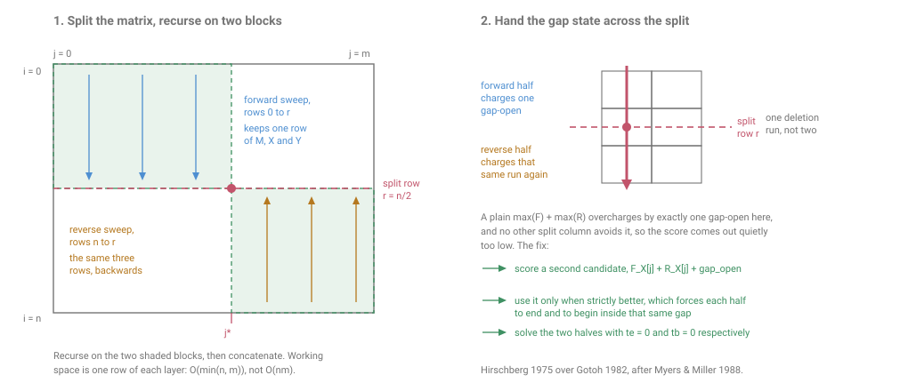

# hirsch

[](https://github.com/janeulzhan/hirsch/actions/workflows/ci.yml)

Optimal global sequence alignment with affine gap penalties, in linear space.
Gotoh's three-layer affine recurrence run under Hirschberg's divide and
conquer, which is the algorithm of Myers and Miller (1988). Written from
scratch in Python and numpy: no Biopython, no parasail, no alignment library
of any kind.

The alignment it returns is provably optimal, not a heuristic. The only thing
that changes against a textbook Gotoh implementation is the memory.

## The memory

Peak memory measured with `tracemalloc`, aligning a sequence against a
homologous partner (12 percent divergence, with indels). Raw numbers in
[`bench/results.csv`](bench/results.csv); harness in
[`bench/benchmark.py`](bench/benchmark.py).

| n | DP cells | quadratic peak | linear peak | ratio |
|---:|---:|---:|---:|---:|
| 100 | <!--bench:cells.n100-->10,100<!--/bench--> | <!--bench:mem.n100_quadratic_bytes tol=8%-->257,422<!--/bench--> B | <!--bench:mem.n100_linear_bytes tol=30%-->27,006<!--/bench--> B | <!--bench:ratio.n100 tol=30%-->9.5<!--/bench-->x |
| 1,000 | <!--bench:cells.n1000-->1,002,001<!--/bench--> | <!--bench:mem.n1000_quadratic_bytes tol=5%-->24,167,696<!--/bench--> B | <!--bench:mem.n1000_linear_bytes tol=25%-->146,216<!--/bench--> B | <!--bench:ratio.n1000 tol=25%-->165.3<!--/bench-->x |
| 5,000 | <!--bench:cells.n5000-->24,939,987<!--/bench--> | <!--bench:mem.n5000_quadratic_bytes tol=5%-->599,141,876<!--/bench--> B | <!--bench:mem.n5000_linear_bytes tol=20%-->672,396<!--/bench--> B | <!--bench:ratio.n5000 tol=20%-->891.1<!--/bench-->x |
| 20,000 | <!--bench:cells.n20000-->400,520,025<!--/bench--> | skipped, needs 9.6 GB | <!--bench:mem.n20000_linear_bytes tol=20%-->2,654,264<!--/bench--> B | n/a |

The quadratic column roughly quadruples each time n doubles; the linear
column roughly doubles. At n = 5,000, the largest size both can run on this
machine, that is
<!--bench:mem.n5000_quadratic_mib tol=5%-->571.4<!--/bench--> MiB against
<!--bench:mem.n5000_linear_mib tol=15%-->0.6<!--/bench--> MiB, a factor of
<!--bench:ratio.n5000 tol=20%-->891.1<!--/bench-->. At n = 20,000 the full
matrix would need three int64 layers over
<!--bench:cells.n20000-->400,520,025<!--/bench--> cells, which is 9.6 GB, so
the oracle is skipped there rather than run; the linear version finishes in
<!--bench:mem.n20000_linear_mib tol=15%-->2.5<!--/bench--> MiB.

Both implementations return the same score at every size the oracle can run,
which the harness asserts: <!--bench:score.n5000_linear-->7,185<!--/bench-->
at n = 5,000, from both.

Peak memory from `tracemalloc` is deterministic (it counts bytes requested,
not resident pages), so these numbers are checked in CI by
[`tools/benchlock.py`](tools/benchlock.py), which re-measures them and fails
if a committed number has drifted past the tolerance declared in its own
marker. **Wall-clock timings are never gated**, in CI or anywhere else; they
live in their own table below and are labelled as such.

## The part that is actually hard

Combining Hirschberg with affine gaps is not a matter of bolting the two
together, and the reason is worth spelling out, because a version that gets
it wrong passes most tests.

Hirschberg picks a split row `r = n/2`, sweeps the DP forward over rows
`0..r` and backward over rows `n..r` keeping one row of each layer, and
chooses the column `j` where the two halves join best. With affine gaps each
half reports three numbers per column, one per gap state: `F_M, F_X, F_Y`
going forward and `R_M, R_X, R_Y` coming back, where `X` is a gap in `y` (a
vertical step, consuming `x`) and `Y` is a gap in `x`.

The obvious combination is `max(F_*) + max(R_*)` over all columns. It is
wrong. Suppose the optimal path enters the split node `(r, j)` on a vertical
edge and leaves it on a vertical edge. Then one deletion run straddles the
split row, and the forward half and the reverse half have each charged a
gap-open for it. The combination overcharges by exactly one `gap_open`. And
no other choice of split column rescues it, because `(r, j)` is the only node
of row `r` on that path.

What makes this nasty is the failure mode. The reported score is never too
high, only too low, and the alignment that comes back is a real alignment,
just not an optimal one. Nothing crashes and nothing looks impossible.



**How this implementation handles it**, in two parts.

*The score.* Each column gets a second candidate,
`F_X[j] + R_X[j] + gap_open`, which refunds the duplicated open. That value
is the exact score of a genuine alignment, so it can never overshoot the
optimum, and it makes the spanning case reachable. The reported optimum is
the maximum over both candidate families and all columns.

*The traceback.* Picking the spanning candidate is not enough: the recursion
then has to force the left half to **end** inside that gap and the right half
to **begin** inside it, or the two halves get concatenated into an alignment
that does not have the score just computed. Both aligners therefore take two
extra parameters, `tb` and `te`, which override the gap-open charged for a
vertical run sitting at the very start or the very end of a subproblem. The
left half is solved with `te = 0` and the right half with `tb = 0`, meaning
"the vertical gap at your boundary continues a run outside you, so do not
charge an open for it".

The forcing is what makes this correct, and it rests on a strictness rule.
The spanning candidate is used **only when strictly greater** than the best
ordinary candidate; ties fall through to the ordinary one. Expanding that
strict inequality gives `F_X[j] + gap_open > F_M[j]` and
`F_X[j] + gap_open > F_Y[j]`, which is exactly the statement that under
`te = 0` the left half's *unique* optimal end state is the vertical gap. Any
optimal solution to that subproblem therefore ends in the gap, and the
induction goes through. The symmetric argument pins the right half's start
state.

Horizontal runs need none of this. Because the split is on rows, a horizontal
run always has a leftmost node in row `r`, and splitting there keeps the run
inside one half. A horizontal run straddling the chosen column is only ever
*over*charged, which the maximisation discards.

### How often it matters

Not rarely. Across the full test grid of three alphabets and five gap
settings, 1,500 seeded random pairs
([`tests/test_gap_handoff.py`](tests/test_gap_handoff.py) re-implements the
naive recombination so this can be measured rather than asserted):

| | pairs | naive recombination wrong |
|---|---:|---:|
| all settings | 1,500 | 772 |
| `gap_open = 0` only | 300 | 0 |

The zero in the second row is the explanation making a falsifiable
prediction: with no open penalty there is nothing to double-charge, so the
naive version must be exact, and it is, in all three alphabets. At every
affine setting it is wrong on roughly half of random pairs. The fixed version
is exact on all 1,500.

## Quickstart

Verified from a fresh clone.

```sh
git clone https://github.com/janeulzhan/hirsch.git
cd hirsch
python3 -m pip install -e ".[test]"
python3 -m pytest -q
hirsch P69905 P68871
```

The only runtime dependency is numpy. Python 3.9 or newer.

```python
from hirsch import linear, quadratic, blosum62

scoring = blosum62(gap_open=11, gap_extend=1)
result = linear.align("MVLSPADKTNVKAAW", "MVHLTPEEKSAVTALW", scoring)
print(result.score, result.aligned_x, result.aligned_y, sep="\n")

# the same answer, the textbook way, using O(nm) memory
assert quadratic.align_score("MVLSPADKTNVKAAW", "MVHLTPEEKSAVTALW", scoring) == result.score

# score only, no traceback, O(min(n, m)) space
linear.align_score("MVLSPADKTNVKAAW", "MVHLTPEEKSAVTALW", scoring)
```

## Example

`hirsch P69905 P68871` fetches two sequences from UniProt and aligns them:
human haemoglobin subunit alpha against subunit beta, two paralogues of the
same ancient gene duplication. Both records are cached in `tests/fixtures/`,
so the demo and the tests run offline; the live fetch is marked `network` and
deselected by default. Full output is committed at
[`docs/example.txt`](docs/example.txt) and a test re-runs the CLI and compares
it byte for byte, so it cannot go stale.

```
HBA_HUMAN     1 MV-LSPADKTNVKAAWGKVGAHAGEYGAEALERMFLSFPTTKTYFPHF------DLSHGS 53
                || |+|.+|+.|.|.||||  +..|.|.|||.|+.+.+|.|+.+|..|      |...|+
HBB_HUMAN     1 MVHLTPEEKSAVTALWGKV--NVDEVGGEALGRLLVVYPWTQRFFESFGDLSTPDAVMGN 58

HBA_HUMAN    54 AQVKGHGKKVADALTNAVAHVDDMPNALSALSDLHAHKLRVDPVNFKLLSHCLLVTLAAH 113
                .+||.|||||..|.++.+||+|++....+.||+||..||.|||.||+||.+.|+..||.|
HBB_HUMAN    59 PKVKAHGKKVLGAFSDGLAHLDNLKGTFATLSELHCDKLHVDPENFRLLGNVLVCVLAHH 118

HBA_HUMAN   114 LPAEFTPAVHASLDKFLASVSTVLTSKYR 142
                ...||||.|.|+..|.+|.|+..|..||.
HBB_HUMAN   119 FGKEFTPPVQAAYQKVVAGVANALAHKYH 147

score            282
alignment length 149 columns
identities       63 (42.3%)
positives        88 of 140 aligned columns (62.9%)
gap columns      9 in 3 run(s)
scoring          BLOSUM62, gap open 11, gap extend 1
aligner          linear
peak memory      93802 bytes (91.6 KB, tracemalloc)
```

42.3 percent identity is the textbook figure for this pair, and the two gaps
fall where the structural alignment puts them: one residue near the N
terminus and the six-residue D helix that alpha globin lacks. Running the
same thing with `--mode quadratic` gives a byte-identical alignment at 538.6
KB peak instead of 91.6 KB.

## How it works

Needleman-Wunsch scores a gap of length `k` as `k` times a per-residue
penalty, which is biologically wrong: one ten-residue indel is a single
mutational event and should not cost ten times a one-residue indel. Gotoh
(1982) fixed that with an affine model, `gap_open + k * gap_extend`,
evaluated by splitting the DP into three layers so that "I am currently
inside a gap" becomes part of the state: `M` for a substitution column, `X`
for a gap in `y`, `Y` for a gap in `x`. That costs O(nm) time and O(nm)
memory. Hirschberg (1975) had already shown, for the simpler linear-gap case,
that the memory can be dropped by solving the problem at the middle row from
both ends at once, keeping only one row of the table, and recursing on the
two halves; the work only doubles. Myers and Miller (1988) combined the two,
and the combination is subtle precisely because Hirschberg's split point now
has to carry gap state across it, as described above. This implementation
follows Myers and Miller, with the three-layer recurrence vectorised per row
in numpy: `M` and `X` depend only on the previous row, and `Y`, which depends
on its own row, unrolls into a prefix maximum that
`numpy.maximum.accumulate` evaluates in one pass.

References: Hirschberg, *CACM* 18(6):341-343 (1975); Gotoh, *J. Mol. Biol.*
162(3):705-708 (1982); Myers and Miller, *CABIOS* 4(1):11-17 (1988).

## Validation

The quadratic aligner in [`hirsch/quadratic.py`](hirsch/quadratic.py) is
deliberately the dumb, obvious one, and it is the oracle for everything else.
It is itself checked by exhaustive enumeration: for every shape up to 4 by 4,
every possible global alignment is generated and scored directly from the
definition of the affine model, across four gap settings and all four `tb`
and `te` combinations.

The centrepiece is the differential property test. Random pairs across three
alphabet sizes (binary, DNA, and the twenty proteinogenic amino acids) and
five gap settings that vary open and extend independently, including the
degenerate `gap_open = 0` case. Every pair asserts three things:

1. the linear-space score equals the quadratic score **exactly** (integers
   throughout, so there is no tolerance to hide in);
2. the alignment returned, re-scored by an independent scorer that shares no
   code with either aligner, equals that score;
3. the gapped strings degap back to the inputs.

| sweep | pairs | where |
|---|---:|---|
| default, runs in CI | <!--bench:pairs.ci-->6,000<!--/bench--> | every push |
| `pytest -m slow`, longer sequences | <!--bench:pairs.slow-->30,000<!--/bench--> | local, 102 s |

Both have been run; both pass. On top of that: a dedicated gap-handoff file
that re-implements the naive recombination and proves it wrong, plus a
constructed family where the optimal alignment is a single long deletion
centred on the split row; edge cases (empty, length 1, identical, disjoint
alphabets, all-gap alignments, 400-to-1 length ratios); determinism, checked
across separate interpreter processes; peak memory growth; BLOSUM62 symmetry
and known entries; and the benchlock gate's own fixtures. 149 tests by
default, 165 with the slow sweep.

```
$ python3 -m pytest -q
149 passed, 1 skipped, 16 deselected in 25.39s
```

That is a fresh clone into a clean virtualenv, following only the quickstart
above. The one skip is the gap-handoff test at `gap_open = 0`, where there is
no open penalty to double-charge and so nothing to check. The 16 deselected
are the slow sweep and the live UniProt fetch; both have been run separately
and both pass.

## Benchmark, wall clock

**Not gated in CI and not reproducible on your machine.** Measured on an
Apple M4, 16 GiB, Python 3.11.9, numpy 2.4.6, one warmup run then five timed
runs per cell.

| n | linear | quadratic |
|---:|---:|---:|
| 100 | 0.006 +/- 0.000 s | 0.001 +/- 0.000 s |
| 1,000 | 0.093 +/- 0.003 s | 0.013 +/- 0.000 s |
| 5,000 | 0.815 +/- 0.022 s | 0.283 +/- 0.038 s |
| 20,000 | 7.173 +/- 0.199 s | skipped, needs 9.6 GB |

## Limitations

Read these before using this for anything.

- **This is not fast.** It is pure Python and numpy. A C implementation such
  as parasail will beat it by one to two orders of magnitude in absolute
  terms. The win here is memory, not speed, and the comparison that matters
  is hirsch against a quadratic Python implementation, not hirsch against C.
- **Linear space costs about 2.8x the time.** At n = 5,000 the linear version
  takes 0.815 s against the oracle's 0.283 s. Myers and Miller roughly double
  the cell work; the recursion overhead accounts for the rest. If your
  sequences are short enough for the full matrix to fit, use the full matrix.
- **"Linear space" means the DP table.** Working space for the dynamic
  programming is O(min(n, m)). Holding the inputs and emitting the alignment
  is inherently O(n + m), and that term is included in every number above. A
  test measures the marginal cost of one more residue of the longer sequence
  at 5.63 bytes, against 4,824 bytes for the oracle at m = 200.
- **Global alignment only.** No local (Smith-Waterman) mode, no semi-global
  or overlap mode, no free end gaps.
- **Integer scores only.** This is deliberate: the differential test asserts
  exact equality against the oracle, and floating point would make that
  assertion meaningless.
- **One scoring matrix is bundled.** BLOSUM62, embedded rather than fetched.
  PAM and the other BLOSUM levels are not included, though any matrix can be
  passed in as a dict.
- **CI gates only deterministic quantities**: `tracemalloc` peak memory,
  alignment scores, DP cell counts, ratios of those, and test pair counts.
  Wall-clock numbers are never asserted on, and `tools/benchlock.py` refuses
  to gate a key outside those families even if one is added by mistake.
- The recursion depth is O(log n), so Python's recursion limit is not a
  practical concern, but it has not been tested above n = 20,000.

## Layout

```
hirsch/quadratic.py   Gotoh, full O(nm) matrix. The oracle.
hirsch/linear.py      Myers-Miller. The point of the repository.
hirsch/scoring.py     Affine gap model, BLOSUM62, independent re-scorer.
hirsch/cli.py         Annotated, coloured alignment output.
hirsch/fasta.py       Minimal FASTA parsing and a keyless UniProt fetch.
bench/                Harness and committed raw CSV.
tools/benchlock.py    Re-measures and verifies the numbers in this README.
```

## Licence

MIT. See [LICENSE](LICENSE).
